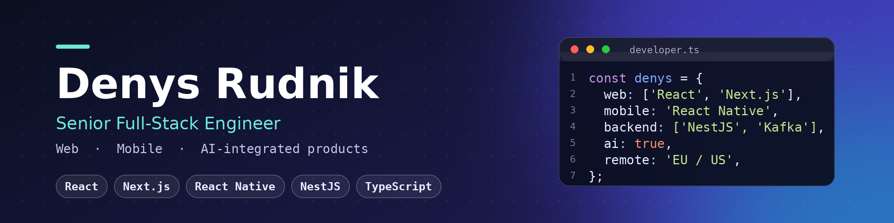

  

<h1 align="center">Denys Rudnik</h1>

  <b>Senior Full-Stack Engineer</b> · React · Next.js · Node/NestJS · React Native 
  6+ years shipping production software for remote teams · Ukraine · Open to remote EU/US roles

  
  
  

---

## Overview

I build products end-to-end: event-driven backends, cross-platform mobile apps and fast web interfaces.
Lately I focus on **AI-integrated products** — from LLM-powered nutrition tracking to on-device AI in a mobile reading app.

|  🌐 **Web** | 📱 **Mobile** | ⚙️ **Backend & Cloud** | 🤖 **AI products** |
|:---|:---|:---|:---|
| React, Next.js, TypeScript, PWA | React Native (CLI & Expo), offline-first, push, deep linking | NestJS, Node.js, RabbitMQ/Kafka, PostgreSQL, AWS, Docker | LLM prompt design, real-time data pipelines, on-device NLU |

---

## Featured work

### 🥗 Forksy — AI-powered nutrition platform
Led full-stack architecture of a conversational diet-tracking platform that turns natural-language food entries into precise nutritional data.

- Custom-tuned LLM prompts parsing free-form meals (~90% accuracy)
- Real-time backend pipeline mapping ingredients to global food databases
- Predictive feedback engine with personalized meal recommendations
- Containerized deployment with optimized caching, sub-second responses

`React` `Node.js` `TypeScript` `PostgreSQL` `OpenAI API` `Docker`  ·  [🔗 Link](https://getforksy.com/))

### 📖 Readmio — Family reading companion
Directed mobile development and architecture of an interactive storytelling app with on-device AI.

- Real-time voice analysis that syncs soundscapes while the user reads aloud
- Adaptive playback pacing based on the reader's voice
- Cross-platform library with downloading and streaming for 50+ titles
- Offline-first data layer for core audio and narrative features

`React Native` `TypeScript` `PostgreSQL` `OpenAI API` `Push notifications`  ·  [🔗 Link](https://www.readmio.com/)

---

## Toolbox

<table>
<tr><td><b>Frontend</b></td><td>

</td></tr>
<tr><td><b>Mobile</b></td><td>

</td></tr>
<tr><td><b>Backend</b></td><td>

</td></tr>
<tr><td><b>Data & Cloud</b></td><td>

</td></tr>
<tr><td><b>Quality & Tools</b></td><td>

</td></tr>
</table>

---

  <b>Looking for a Senior Full-Stack / Mobile engineer on a remote-first team?</b> 
  Message me on <a href="https://www.linkedin.com/in/[your-handle]">LinkedIn</a> or <a href="mailto:[your@email.com]">email</a>.

